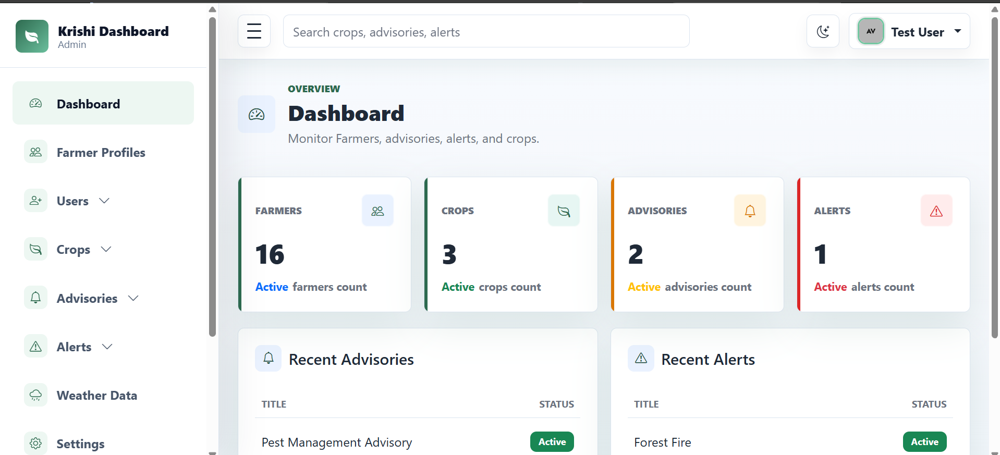
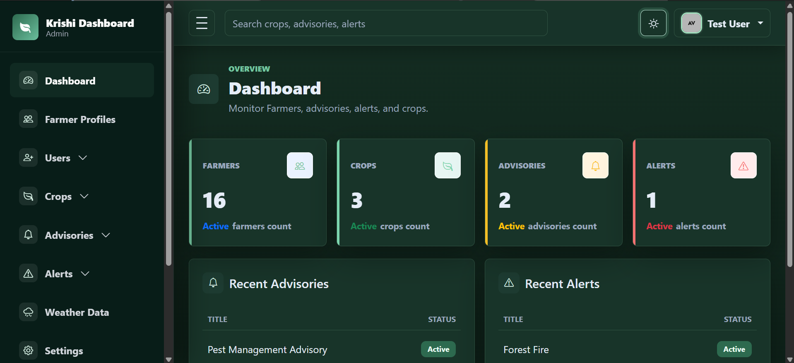
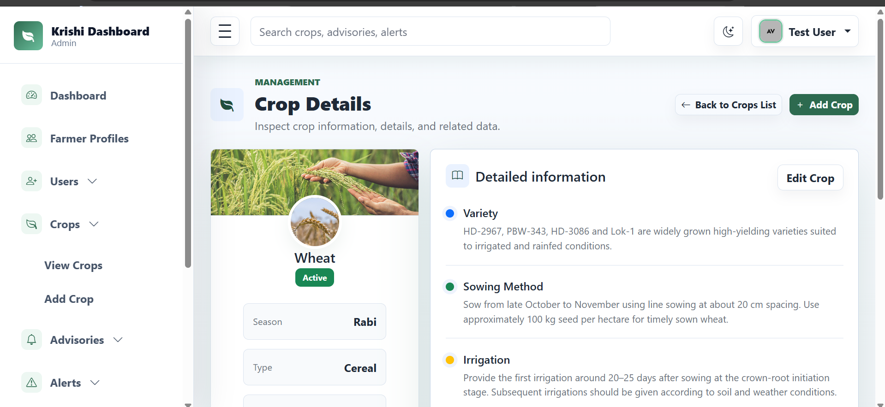
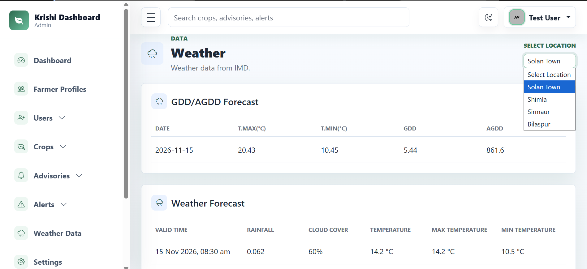
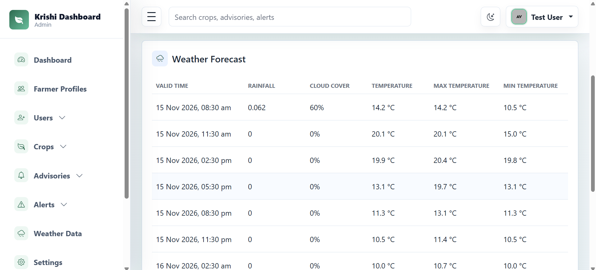

# Laravel Firebase Farmer Platform

The backend and administrative panel for a farmer-focused mobile application. The mobile client consumes this Laravel project's versioned API; this repository contains the backend services and web dashboard, not the mobile app itself.

## Project scope

My contribution was building the Laravel backend and web-based admin panel that support the companion mobile app. The API provides authentication and farmer-facing services, while the dashboard gives administrators and editors tools to manage users, farmers, crops, advisories, and alerts.

## Features

- Phone OTP and JWT authentication for the mobile app API
- Optional Google OAuth sign-in
- Firebase-backed farmer accounts and profile data
- Role-based admin and editor dashboard
- Farmer, user, crop, advisory, and alert management
- Weather and Growing Degree Day (GDD) data by location
- Cached weather and GDD responses to reduce repeated upstream requests
- Scheduled station-data synchronization
- Location search and popular locations
- API endpoints for farmer settings, weather, advisories, and alerts

## Data sync and caching

Weather lookups and GDD data are cached for 30 minutes to reduce repeated requests to the external data feeds. Station records are refreshed from the upstream stations feed by the `stations:sync` Artisan command, scheduled to run every six hours. The sync updates current station records and marks stations absent from the latest feed as inactive.

The schedule is defined in `routes/console.php`. Run `php artisan schedule:work` in a separate local terminal to run scheduled tasks during development; production deployments should configure Laravel's scheduler.

### Nearby weather station lookup

For mobile weather requests, `WeatherService` rounds the requested coordinates to two decimal places, then compares them with active stations in Himachal Pradesh. It calculates great-circle distance with the Haversine formula (using an Earth radius of 6,371 km), selects the nearest station, and returns it only when it is within 50 km. The response includes the distance rounded to two decimal places.

## Tech stack

- PHP 8.3+ and Laravel 13
- Firebase PHP SDK and Laravel Socialite
- JWT authentication and Spatie Laravel Permission
- SQLite by default; MySQL/MariaDB are also supported
- Vite, Tailwind CSS, and Alpine.js
- Pest

## Screenshots











## Getting started

### Requirements

- PHP 8.3+ with the extensions required by Laravel
- Composer
- Node.js and npm
- SQLite, MySQL, or MariaDB

Firebase and Google OAuth credentials are needed only for the corresponding integrations.

### Install

```bash
composer install
cp .env.example .env
php artisan key:generate
```

The default database connection is SQLite. Create its local database file if it does not exist:

```bash
php -r "if (!file_exists('database/database.sqlite')) { touch('database/database.sqlite'); }"
```

For MySQL or MariaDB, set `DB_CONNECTION`, `DB_HOST`, `DB_PORT`, `DB_DATABASE`, `DB_USERNAME`, and `DB_PASSWORD` in `.env`.

Install the JavaScript dependencies, run migrations and seed the roles/permissions, then build the frontend:

```bash
npm install
php artisan migrate --seed
npm run build
```

### Optional integrations

Set these values in your local `.env` file when enabling the related integrations:

- **Firebase:** Set `FIREBASE_DATABASE_URL` and `FIREBASE_CREDENTIALS`. Place your service-account JSON at `storage/app/credentials/firebase-service-account.json`; this folder is ignored by Git. Never commit the service-account file.
- **JWT:** Generate a signing secret with `php artisan jwt:secret`.
- **Google OAuth:** Set `GOOGLE_CLIENT_ID`, `GOOGLE_CLIENT_SECRET`, and `GOOGLE_REDIRECT_URI`. Register the callback URL `http://localhost:8000/api/v1/auth/google/callback` with your OAuth provider.

The sample environment file contains variable names only; supply real values locally or through your deployment's secret manager.

### Create an administrator

The seeders create roles and permissions, but intentionally do not create a shared demo account. Register a local user at `/register`, then grant that user the admin role:

```bash
php artisan tinker --execute "App\Models\User::where('email', 'you@example.com')->firstOrFail()->assignRole('admin');"
```

Use the email address you registered with. Do not use shared or default credentials in a deployed environment.

### Run locally

```bash
composer run dev
```

This starts the Laravel server, queue worker, and Vite development server. The dashboard is available at `http://localhost:8000`.

## API

The versioned API is under `/api/v1`. Examples include:

| Method | Endpoint | Purpose |
| --- | --- | --- |
| `POST` | `/api/v1/auth/otp/send` | Send a farmer OTP |
| `POST` | `/api/v1/auth/otp/verify` | Verify an OTP and authenticate |
| `POST` | `/api/v1/auth/refresh` | Refresh a JWT |
| `GET` | `/api/v1/auth/google` | Start Google sign-in |
| `GET` | `/api/v1/user/me` | Get the authenticated farmer |
| `PATCH` | `/api/v1/user/locations/update` | Update the farmer's location |
| `GET` | `/api/v1/user/weather` | Get weather for the farmer's location |
| `GET` | `/api/v1/user/advisories` | List advisories |
| `GET` | `/api/v1/user/alerts` | List alerts |
| `GET` | `/api/v1/user/locations/search` | Search locations |

Except for the authentication endpoints, API routes require a valid JWT. See [routes/api.php](routes/api.php) for the complete route definitions.

## Tests

```bash
php artisan test
```

## Security

- Keep `.env`, `.env.web`, Firebase service-account files, and all production credentials out of version control.
- The repository ignores local environment files and `storage/app/credentials/`; verify `git status` before pushing.
- Use unique secrets and accounts per environment. If a credential was ever committed or shared, revoke or rotate it; deleting it from the current files does not remove it from Git history.
